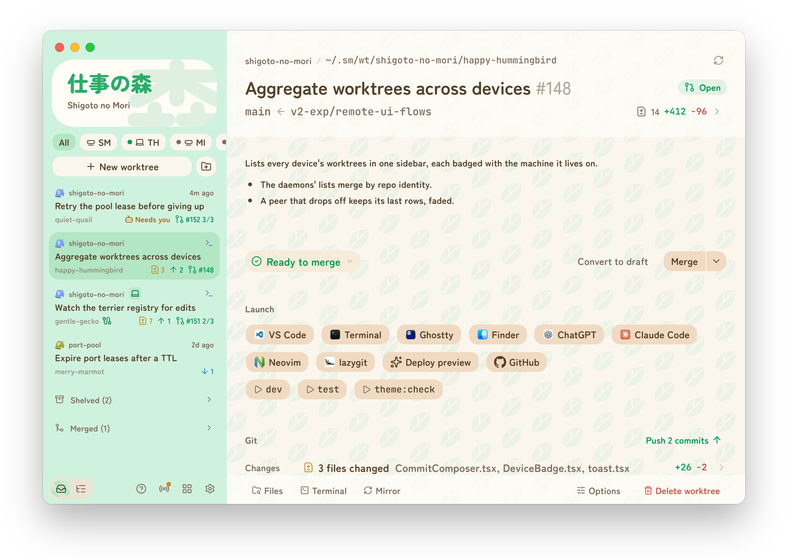

# Shigoto no Mori

A desktop app for managing many git worktrees in parallel.

It comes with a focused GUI and one-click launchers per worktree (editor, shell, agent CLI, or anything configurable per project). It is agent- and platform-agnostic by design.



`Shigoto no Mori` plays on *Doubutsu no Mori* (Animal Crossing), "work forest", and the idea of a forest of worktrees: many pieces of work growing side by side without becoming chaos.

## On Linux

A Linux machine, such as a server you reach over SSH, runs the app with no window. It runs only the host process, which the terminal `sm` and your other devices drive. It requires x86_64, glibc 2.35 or newer (Ubuntu 22.04, Debian 12), and systemd.

```sh
curl -fsSL https://raw.githubusercontent.com/sylophi/shigoto-no-mori/main/install.sh | sh
```

The installer stores its versions in `~/.local/share/shigomori`, links `sm` into `~/.local/bin`, and runs the host as a systemd user service, starting at boot when lingering is enabled (`sm service status`). `sm update` upgrades to the latest release, and `sm nuke --yes` removes the entire installation from the machine.

`sm login` adds the machine as one of your devices: it shows a code to approve in a browser on any device signed in to your account. `sm logout` removes the machine from your account.

## Repository

| Folder | What it is |
| --- | --- |
| [`app/`](app/) | The Electron desktop app and the web client |
| [`marketing/`](marketing/) | The shigomori.com site, built with Astro |
| [`lint/`](lint/) | The repo's own oxlint rules |
| [`packages/`](packages/) | The workspace packages: `contracts` (what crosses a wire), `engine` (the data model, store, and git), `ui` (views and the fixture world), and `cli` (the terminal `sm`) |
| [`file-sync/`](file-sync/) | The worktree mirroring engine, a Go module bundled into the app |
| [`nativefs/`](nativefs/) | A Go module bundled into the app for filesystem calls Node lacks. On macOS and Linux: copy-on-write clone, exchange, flags, xattrs, lstat with private size, and whether a volume can clone. On Windows: lstat, the process table, jobs, and the user's PATH |
| [`cli-launcher/`](cli-launcher/) | A Go module bundled into the app for the Windows terminal command on PATH, which runs the installed app's `sm` |
| [`skills/`](skills/) | Agent skills for the `sm` workflow (see below) |
| [`test/`](test/) | Shared helpers used by every test runner and the lab's harnesses: [`gitIsolation.ts`](test/gitIsolation.ts) keeps a run's git operations isolated from this repository, [`testTemp.mts`](test/testTemp.mts) gives each run its own temp folder, and [`testProcesses.mts`](test/testProcesses.mts) terminates processes the run started |

The JavaScript packages share one pnpm workspace ([`pnpm-workspace.yaml`](pnpm-workspace.yaml)) and one lockfile. Run `pnpm install` at the root, then `pnpm run postinstall`. Install scripts are disabled, so `pnpm run postinstall` runs each package's own setup (the app's icons and its node-pty helper). [`pnpm-workspace.yaml`](pnpm-workspace.yaml) holds the supply-chain settings and the catalog that pins the versions the packages share.

Root scripts run the app's scripts through pnpm filters (`pnpm dev`, `pnpm test`), while `pnpm typecheck` typechecks every package. `pnpm -C <package> …` works as well. Repo-wide checks ([`lefthook.yml`](lefthook.yml), [`.oxlintrc.json`](.oxlintrc.json), [`.oxfmtrc.json`](.oxfmtrc.json), [`knip.jsonc`](knip.jsonc)) and their tools live at the root, and `pnpm check` runs every check that CI runs.

Each folder documents itself:

- [`app/README.md`](app/README.md): the app's layout
- [`app/DESIGN.md`](app/DESIGN.md): the app's visual rules
- [`app/lab/README.md`](app/lab/README.md): testing by hand on the real UI
- [`app/test/README.md`](app/test/README.md): the app's proofs
- [`app/ACCOUNT.md`](app/ACCOUNT.md): the account service the app signs in to
- [`marketing/README.md`](marketing/README.md): the marketing site
- [`lint/README.md`](lint/README.md): the repo's lint rules
- [`EFFECT.md`](EFFECT.md): the conventions every Effect change follows

Each package under `packages/` also has a README of its own.

## Agent skills

[`skills/`](skills/) contains instruction snippets that teach coding agents the `sm` workflow:

- `sm-basics`: register, relocate, or unregister a project, and create a worktree, rename its branch, land it, or tear it down.
- `sm-for-agents`: features built for agentic work (a worktree's title and description, and links into the app).
- `sm-remote`: send a worktree to another of your machines, bring one over, or mirror it.

Install them with [Vercel skills](https://github.com/vercel-labs/skills) (skills.sh). The installer lets you pick which skills to include:

```sh
npx skills add https://github.com/sylophi/shigoto-no-mori
```

## License

Shigoto no Mori is licensed under the MIT License. See [LICENSE](LICENSE).
