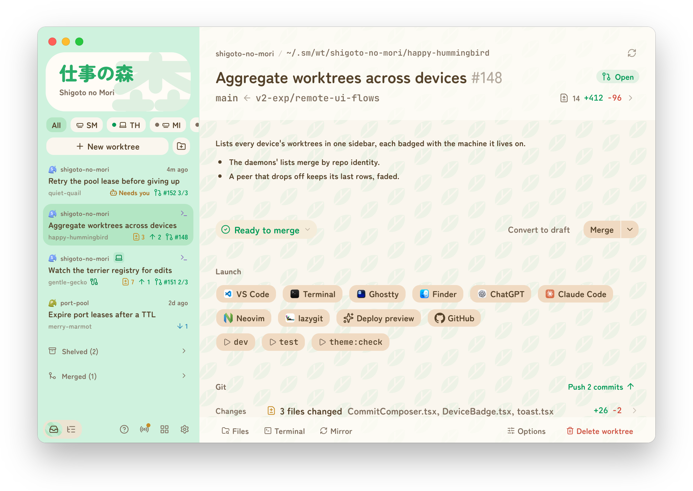

# Shigoto no Mori

A desktop app for managing many git worktrees in parallel.

Comes with a focused GUI and one-click launchers per worktree (editor, shell, agent CLI, anything configurable per project). Agent and platform-agnostic by design.



`Shigoto no Mori` plays on *Doubutsu no Mori* (Animal Crossing), "work forest", and the idea of a forest of worktrees: many pieces of work growing side by side without becoming chaos.

## On Linux

A Linux machine, such as a server you reach over SSH, runs the app with no window: its host, which the terminal `sm` and your other devices drive. It needs x86_64, glibc 2.35 or newer (Ubuntu 22.04, Debian 12) and systemd.

```sh
curl -fsSL https://raw.githubusercontent.com/sylophi/shigoto-no-mori/main/install.sh | sh
```

The install keeps its versions in `~/.local/share/shigomori`, links `sm` into `~/.local/bin`, and runs the host as a systemd user service, from boot where lingering is on (`sm service status`). `sm update` moves it to the latest release, and `sm nuke --yes` takes everything of it off the machine.

`sm login` makes the machine one of your devices: it shows a code to approve in a browser on any device, signed in to your account. `sm logout` takes it off the account.

## Repository

| Folder | What it is |
| --- | --- |
| `app/` | The Electron desktop app and the web client |
| `hub/` | The device hub, a Cloudflare Worker |
| `marketing/` | The shigomori.com site, built with Astro |
| `lint/` | The repo's own oxlint rules |
| `packages/` | The workspace packages: `contracts` (what crosses a wire), `engine` (the data model, the store and git), `ui` (the views and the fixture world), and `cli` (the terminal `sm`) |
| `file-sync/` | The worktree mirroring engine, a Go module bundled into the app |
| `nativefs/` | The filesystem calls Node lacks, on macOS and Linux (copy-on-write clone, exchange, flags, xattrs, lstat with private size, whether a volume can clone), a Go module bundled into the app |
| `skills/` | Agent skills for the `sm` workflow (below) |
| `test/` | What every test runner and the lab's harnesses share: `gitIsolation.ts` keeps a run's git off this repository, `testTemp.mts` gives the run a temp folder of its own, and `testProcesses.mts` ends what the run started |

The JavaScript packages are one pnpm workspace (`pnpm-workspace.yaml`)
with one lockfile: run `pnpm install` at the root, then
`pnpm run postinstall`. Install scripts are off, so that second command
is what runs the packages' own setup (the app's icons and its node-pty
helper). The workspace file
holds the supply-chain settings and the catalog that pins the versions
the packages share. The root scripts run the app's through pnpm filters
(`pnpm dev`, `pnpm test`), and `pnpm typecheck` runs every package's.
`pnpm -C <package> …` works too. The repo-wide checks (`lefthook.yml`,
`.oxlintrc.json`, `.oxfmtrc.json`, `knip.jsonc`) and their tools stay at
the root. `pnpm check` runs every check CI runs.

Each folder documents itself: [`app/README.md`](app/README.md) is the
app's layout, [`app/DESIGN.md`](app/DESIGN.md) its visual rules,
[`app/lab/README.md`](app/lab/README.md) how to test it by hand on the
real UI, [`app/test/README.md`](app/test/README.md) its proofs, [`hub/README.md`](hub/README.md) the device hub,
[`marketing/README.md`](marketing/README.md) the site,
[`lint/README.md`](lint/README.md) the repo's lint rules, and each
package under `packages/` has a README of its own.
[`EFFECT.md`](EFFECT.md) holds the conventions every Effect change
follows.

## Agent skills

`skills/` holds instruction snippets that teach coding agents the `sm`
workflow: `sm-basics` (register, relocate or remove a project, create
a worktree, rename its branch, land it and tear it down),
`sm-for-agents` (the features built for agentic work: a worktree's
title and description, agent sessions, links into the app) and
`sm-remote` (send a worktree to another of your machines, bring one
over, or mirror it).
Install with [Vercel skills](https://github.com/vercel-labs/skills)
(skills.sh); the installer lets you pick which ones to include:

```sh
npx skills add https://github.com/sylophi/shigoto-no-mori
```

## License

Shigoto no Mori is licensed under the MIT License. See [LICENSE](LICENSE).
